# DTSF v0.2.0 — Architecture Diagrams

**Status:** updated for DTSF v0.2.0 (alfa). The v0.1.2 diagram is preserved in §6 for reference.

---

## 1. Framework Overview

The v0.1.2 framework had seven pillars on one plane. v0.2.0 adds a **quantum-safe cryptographic core** underneath them and a **transport-domain layer** above them, because the same pillar means different things on a subsea cable and on an acoustic modem.

```
                        ┌───────────────────────────────────────────┐
                        │   DATA TRANSFER SECURITY FRAMEWORK v0.2.0 │
                        │        (Quantum & Multi-Domain)           │
                        └────────────────────┬──────────────────────┘
                                             │
        ┌────────────────────────────────────┼────────────────────────────────────┐
        │                                    │                                    │
┌───────▼─────────┐              ┌───────────▼──────────┐             ┌───────────▼──────────┐
│  LAYER 1        │              │  LAYER 2             │             │  LAYER 3             │
│  QUANTUM-SAFE   │              │  SECURITY PILLARS    │             │  TRANSPORT DOMAINS   │
│  CRYPTO CORE    │              │  (v0.1.2, retained)  │             │  (new in v0.2.0)     │
├─────────────────┤              ├──────────────────────┤             ├──────────────────────┤
│ PQC (ML-KEM,    │              │ 1 Encryption         │             │ Terrestrial / Cloud  │
│  ML-DSA,SLH-DSA)│              │ 2 Secure Protocols   │             │ Space                │
│ Hybrid KEX      │◄────────────►│ 3 Authentication     │◄───────────►│ Aeronautical         │
│ AES-256/SHA-384 │   applies    │ 4 Access Controls    │   profiled  │ Underwater (cable)   │
│ QKD  (overlay)  │     to       │ 5 Data Integrity     │     per     │ Underwater (wireless)│
│ QRNG (entropy)  │              │ 6 Logging & Monitor. │             │ Wireless             │
│ Crypto-agility  │              │ 7 Compliance         │             │ Storage (at rest)    │
└─────────────────┘              └──────────────────────┘             └──────────────────────┘
        │                                    │                                    │
        └────────────────────────────────────┼────────────────────────────────────┘
                                             │
                   ┌─────────────────────────┴──────────────────────────┐
                   │  LAYER 4 — GOVERNANCE & EMERGING TECHNOLOGY        │
                   │  Zero Trust · DPF/GDPR compliance · DLT & identity │
                   │  AI/agent integration · Migration roadmap          │
                   └───────────────────────────┬────────────────────────┘
                                               │
                                    ┌──────────▼──────────┐
                                    │   BEST PRACTICES    │
                                    │   & CERTIFICATION   │
                                    └─────────────────────┘
```

---

## 2. Domain Profile Selection

Which cryptographic profile applies is decided by the **link**, not by the data.

```
                          ┌────────────────────────┐
                          │  Data transfer request │
                          └───────────┬────────────┘
                                      │
                        Is the link bandwidth-constrained?
                                      │
                ┌─────────────────────┴──────────────────────┐
               NO                                           YES
                │                                            │
      ┌─────────▼──────────┐                  Can a handshake be done off-link?
      │   PROFILE Q-A      │                                 │
      │   Unconstrained    │                ┌────────────────┴─────────────────┐
      ├────────────────────┤               YES                                NO
      │ Hybrid X25519 +    │                │                                  │
      │   ML-KEM-768       │      ┌─────────▼──────────┐            ┌──────────▼─────────┐
      │ ML-DSA-65 certs    │      │   PROFILE Q-B      │            │   PROFILE Q-C      │
      │ AES-256-GCM        │      │   Amortised        │            │   Symmetric-only   │
      │ Per-session KEX    │      ├────────────────────┤            ├────────────────────┤
      └────────────────────┘      │ Ground/broadband   │            │ Physical key       │
                                  │   handshake        │            │   injection        │
      Subsea cable · Cloud        │ KDF ratchet in air │            │ KDF ratchet        │
      Ground segment · Wi-Fi      │ AES-256-GCM        │            │ Ascon / AES-256    │
      Broadband SATCOM            │ Symmetric MAC      │            │ Courier rekey      │
                                  └────────────────────┘            └────────────────────┘
                                   ACARS/VDL2 · HFDL                 Underwater acoustic
                                   Spacecraft TC/TM                  Deep space · DTN
                                                                     Legacy avionics
```

---

## 3. Layered Protection on a Transatlantic Transfer

The concrete answer to "what is a supplementary measure?" — independent layers with **independent key custody**.

```
  EU Controller                                                     US Processor
 ┌──────────────┐                                                 ┌──────────────┐
 │ Application  │═══════ TLS 1.3  hybrid X25519MLKEM768 ═════════▶│ Application  │  ← customer key custody
 └──────┬───────┘         (end-to-end, PQ, customer keys)         └──────▲───────┘
        │                                                                │
 ┌──────▼───────┐                                                 ┌──────┴───────┐
 │ IPsec GW     │──────── IKEv2 + RFC 9370 / RFC 8784 ───────────▶│ IPsec GW     │  ← optional L3
 └──────┬───────┘                                                 └──────▲───────┘
        │                                                                │
 ┌──────▼───────┐                                                 ┌──────┴───────┐
 │ Edge router  │──────── MACsec 802.1AE  AES-256-GCM ───────────▶│ Edge router  │  ← operator custody
 └──────┬───────┘                                                 └──────▲───────┘
        │                                                                │
 ┌──────▼───────┐                                                 ┌──────┴───────┐
 │ Transponder  │──────── OTN Layer-1  AES-256-GCM ──────────────▶│ Transponder  │  ← carrier custody
 └──────┬───────┘                                                 └──────▲───────┘
        │                                                                │
        └───►  ~~~~ SUBSEA CABLE : repeaters every 50–80 km ~~~~ ────────┘
                 ▲                          ▲                    ▲
              tap risk               cut / sabotage         HNDL capture
              (landing stn)           (anchor drag)       (bulk recording)

   Note: optical amplification destroys quantum states →  QKD is NOT possible
         on this path. Intercontinental QKD must go via satellite.
```

---

## 4. Key Hierarchy (all domains)

```
                  ┌──────────────────────────────────────┐
                  │  ROOT OF TRUST                       │
                  │  HSM / KMS, FIPS 140-3 L3+           │
                  │  SLH-DSA or LMS/XMSS trust anchor    │  ← hash-based: outlives the mission
                  └──────────────┬───────────────────────┘
                                 │  ML-KEM-1024 wrapping · ML-DSA-87 attestation
              ┌──────────────────┼──────────────────┬───────────────────┐
              │                  │                  │                   │
     ┌────────▼───────┐ ┌────────▼───────┐ ┌────────▼───────┐ ┌─────────▼──────┐
     │ Domain Key     │ │ Domain Key     │ │ Domain Key     │ │ Domain Key     │
     │ (jurisdiction) │ │ (mission/tail) │ │ (cable system) │ │ (device fleet) │
     └────────┬───────┘ └────────┬───────┘ └────────┬───────┘ └─────────┬──────┘
              │                  │                  │                   │
      AES-256-KW          Pre-launch/            MKA CAK          Physical injection
              │           pre-flight injection       │            (factory / courier)
     ┌────────▼───────┐ ┌────────▼───────┐ ┌────────▼───────┐ ┌─────────▼──────┐
     │ DEK per record │ │ SDLS session   │ │ MACsec SAK     │ │ K_n  ratchet   │
     │ (crypto-erase) │ │ keys (OTAR)    │ │ (rotating)     │ │ K_{n+1}=KDF(K_n)│
     └────────────────┘ └────────────────┘ └────────────────┘ └────────────────┘
        Storage             Space              Subsea cable       Underwater /
                                                                  constrained wireless
```

---

## 5. Data Lifecycle with v0.2.0 Controls

```
 GENERATE ──► PROCESS ──► TRANSFER ──► STORE ──► ARCHIVE ──► DISPOSE
    │            │            │           │          │            │
    │            │            │           │          │            └─ Crypto-erasure:
    │            │            │           │          │               destroy per-record DEK
    │            │            │           │          │               + evidence record
    │            │            │           │          └─ Cryptographic renewal cycle:
    │            │            │           │             re-encrypt & re-timestamp before
    │            │            │           │             algorithm deprecation
    │            │            │           └─ AES-256 + PQ-wrapped KEK
    │            │            │              WORM copy · customer key custody
    │            │            └─ Domain profile Q-A / Q-B / Q-C
    │            │               Layered encryption · independent custody
    │            └─ Input validation · agent identity & capability scoping
    │               Model output treated as untrusted input
    └─ Classification · legal basis · retention decision  ◄── drives everything downstream

 Continuous:  Zero Trust verification · logging & monitoring · CBOM currency · crypto-agility
```

---

## 6. Legacy Diagram (DTSF v0.1.2)

Retained for reference.

```
                    +---------------------+
                    |    Data Transfer    |
                    |    Security         |
                    |    Framework        |
                    +----------+----------+
                               |
           +-------------------+---------------------+
           |                   |                     |
   +-------v--------+  +-------v---------+  +--------v-------+
   |  Encryption    |  |  Secure         |  |  Authentication|
   |                |  |  Protocols      |  |                |
   +-------+--------+  +-------+---------+  +--------+-------+
           |                   |                     |
   +-------v--------+  +-------v---------+           |
   |  Access        |  |  Data           |           |
   |  Controls      |  |  Integrity      |           |
   +-------+--------+  +-------+---------+           |
           |                   |                     |
   +-------v--------+  +-------v--------+            |
   |  Logging and   |  |  Compliance    |            |
   |  Monitoring    |  |  Standards     |            |
   +-------+--------+  +----------------+------------+
           |
           v
   +-------v--------+
   |   Best         |
   |   Practices    |
   +----------------+
```

---

## 7. Rendered View (Mermaid)

```mermaid
flowchart TB
    DTSF["DTSF v0.2.0<br/>Quantum &amp; Multi-Domain"]

    subgraph CORE["Layer 1 — Quantum-Safe Crypto Core"]
        PQC["PQC<br/>ML-KEM · ML-DSA · SLH-DSA"]
        SYM["Symmetric<br/>AES-256 · SHA-384"]
        QKD["QKD overlay<br/>optional"]
        QRNG["QRNG entropy"]
        AGIL["Crypto-agility<br/>CBOM · fallback"]
    end

    subgraph PILLARS["Layer 2 — Security Pillars"]
        P1["Encryption"]
        P2["Secure Protocols"]
        P3["Authentication"]
        P4["Access Controls"]
        P5["Data Integrity"]
        P6["Logging &amp; Monitoring"]
        P7["Compliance"]
    end

    subgraph DOMAINS["Layer 3 — Transport Domains"]
        D1["Terrestrial / Cloud<br/>Profile Q-A"]
        D2["Space<br/>Q-B / Q-C · CCSDS SDLS"]
        D3["Aeronautical<br/>Q-B · ARINC 823"]
        D4["Underwater cable<br/>Q-A · layered L1/L2/L4"]
        D5["Underwater wireless<br/>Q-C · Ascon · BPSec"]
        D6["Wireless<br/>Q-A / Q-C · EAP-TLS PQ"]
        D7["Storage at rest<br/>PQ-wrapped KEK"]
    end

    subgraph GOV["Layer 4 — Governance &amp; Emerging Technology"]
        G1["Zero Trust"]
        G2["GDPR / EU-U.S. DPF"]
        G3["DLT &amp; digital identity"]
        G4["AI &amp; autonomous agents"]
        G5["PQ migration roadmap"]
    end

    DTSF --> CORE --> PILLARS --> DOMAINS --> GOV
```


